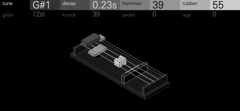
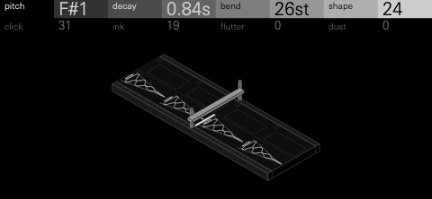
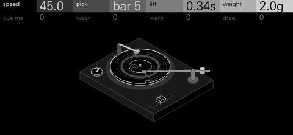

# Trigon Suite

Three synthesis drum kits for the OP-XY, built with the
[Open-XY SDK](https://github.com/etcetc000/open-xy). Each one starts from a
way rhythm was made by hand before drum machines (a piano with bolts between
its strings, sound drawn straight onto film, a soul 45 on a record player)
and turns it into a full kit: 24 keys, each with its own sound, its own eight
controls and its own mixer channel, and a screen that draws the object you
are playing.

They are the drum kits to go with the
[Hexagon Suite](https://github.com/mmockett/OP-XY-Hexagon): worn, warm and
soft, and tight in a groove as they come.

**Status: experimental.** All three run on the OP-XY. Their CPU use is
counted in the compiled code, not yet measured on the OP-XY (below).

## The kits

<table>
<tr>
<td width="50%"></td>
<td>

### FELT

An upright piano prepared the way John Cage prepared his, played as a drum
kit. Rubber at a string's end turns it into a deep, round kick; paper woven
through the strings buzzes into a snare; a bolt bends a string's partials into
a gong; a brush along the top strings is a hi-hat. The pedal lifts every
damper, and the strings above the note ring in sympathy.

**Models:** THUD, RATTLE, TOM, LID, TACK, BELL, BRUSH, PLANK, CHAIN, BOLT,
PLUCK, BOW<br>
**Shift, second row:** TUNE, SOFT (the una corda), FX I, FX II

The screen is a textbook plate of the prepared strings: three unisons over the
iron plate, the bridge that tunes them, the damper, the hammer rising from
beneath, and whatever is wedged between them, which changes with the model.
Each part's grey is the encoder that moves it. *Shown: THUD, the kick.*
[More about FELT](felt/README.md)

</td>
</tr>
<tr>
<td width="50%"></td>
<td>

### FLICKER

A kit drawn on film, the way Norman McLaren and Daphne Oram drew sound onto
an optical soundtrack. Round drawn sines for kicks and toms, inked dots for
rims, scratches through the emulsion for snares, ruled lines for hats, a
drawn bass. Every sound passes through the same projector: its slit, its
valve amplifier's warmth, and when you ask for them its flutter and dust.

**Models:** SWEEP, SCRATCH, RING, STROKES, DOT, CARD, HATCH, ORNAMENT,
STIPPLE, BOOP, WAVE, CLAW<br>
**Shift, second row:** TUNE, SLIT (the sound slit), FX I, FX II

The screen is four frames of film lying on a slat, the key's sound drawn on
the soundtrack, the pencil guides of its taper beside it and a gate with the
slit's light across the middle. Each hit pulls the film one frame along.
*Shown: SWEEP, the kick.*
[More about FLICKER](flicker/README.md)

</td>
</tr>
<tr>
<td width="50%"></td>
<td>

### DUST

A soul 45 on a portable record player, played the way a beatmaker plays a
break. Every key is a hit from the record: a felt-beaten kick, a snare
cracking in a small room, hats with the ride bleeding in, congas, a
tambourine, the bass player's note. The same eight controls sit on every key,
and they are the record player's.

**Controls:** SPEED, PICK, LIFT, WEIGHT, CUE, WEAR, WARP, DRAG<br>
**Shift, second row:** TUNE, TONE, FX I, FX II

The screen is a record deck in isometric. The record's size follows the
speed, the arm sits on the bar you pick and lifts when the hit ends, the
grooves wander as the copy wears, and the dust brush drops onto the record as
it drags. Each part's grey is the encoder that moves it. *Shown: the kick.*
[More about DUST](dust/README.md)

</td>
</tr>
</table>

## Playing them

Load a kit on a drum track. Every key holds its own sound and eight controls
on two rows (press an encoder to switch rows), and the project saves them.
Hold **Shift** for the key's mixer channel: its sound, choke group, pan and
level on the first row; TUNE, the kit's own setting and the key's FX I and
FX II sends on the second. Each kit comes with a default kit and eight kit
presets for different styles, listed in its README with demos to listen to.

## CPU

Estimates, not yet measured on an OP-XY: the instructions in one voice's
heaviest audio block, counted in the code the SDK's Blackfin compiler builds,
as a share of the OP-XY's audio block. Each kit's README lists every model
(FLICKER's also gives a looser upper bound). Pipeline stalls are not
counted, so the OP-XY's own figures will be higher.

| Kit | Lightest model | Heaviest model |
| --- | ---: | ---: |
| FELT | 2.2% | 3.5% |
| FLICKER | 2.4% | 3.4% |
| DUST | 2.7% | 3.4% |

## Building

The kits need SDK 1.10, with the per-key mixer channels of
[etcetc000/open-xy#399](https://github.com/etcetc000/open-xy/pull/399), which
is in the SDK's `staging` branch. Until that reaches the
[builder](https://open-xy.com), build them yourself.

Check the SDK out beside this repository and fetch its toolchain:

```sh
git clone -b staging https://github.com/etcetc000/open-xy ../open-xy
(cd ../open-xy && python sdk.py toolchain fetch)
```

Then, from this repository:

```sh
python ../open-xy/sdk.py test --machine felt --machine flicker --machine dust
python ../open-xy/sdk.py build --machine felt --machine flicker --machine dust --stock-os <your stock-1.2.1>/os.ldr --layout <your last build's layout.json> --out <folder outside this checkout>
```

Install the build's `candidate/` files as the SDK's
[build guide](https://github.com/etcetc000/open-xy/blob/staging/docs/build.md#5-install)
describes. Pass your last build's `layout.json` so the machines already on
your OP-XY keep their numbers. A command-line build installs no presets: each
kit's `tools/presets.py` writes its kit presets into the build, as its README
describes.

## Licence

MIT ([LICENSE](LICENSE)).
