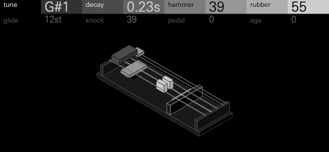
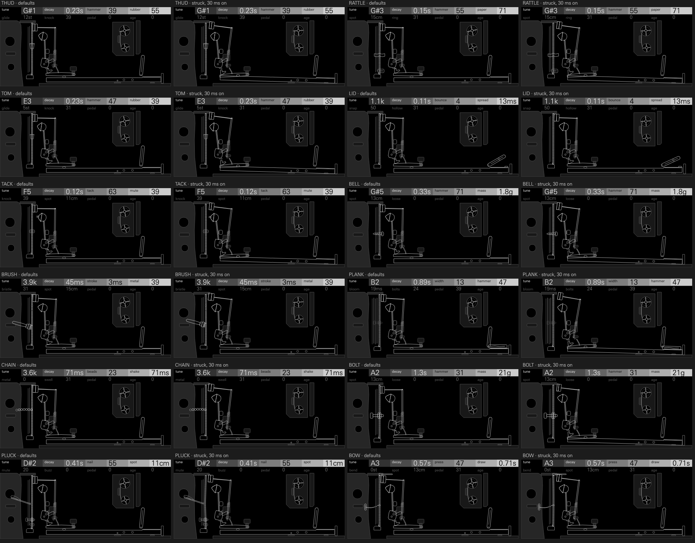

# FELT



An old upright piano from the parlour, prepared the way John Cage prepared
his, and played as a drum kit. Bolts, screws, rubber and paper sit between
its strings; every key of the kit is one note of that piano and whatever is
wedged in it, struck by its felt hammer, or plucked, brushed, bowed, rattled
with beads or slapped with the fallboard. Rubber turns a bass string into a
deep, round kick; paper woven through a tenor string buzzes into a snare; a
bolt bends a string's partials into a gong; a stiff brush along the top
strings is a hi-hat. It sounds warm, wooden and close: felt knocks, buzzing
paper snares, bolted gongs, a piano-bass pizzicato, the pedal's halo.

**Origin:** the prepared piano. In 1940 John Cage was asked for music for a
dance in a hall too small for a percussion ensemble. He laid a pie plate on
the piano's strings, then wedged screws, bolts, rubber and weather stripping
between them, and the piano became a percussion orchestra of thuds, gongs,
rattles and bells, each note its own instrument, set by where on its string
the object sits and how heavy it is.

A piano string's partials sit at n f0 √(1 + B n²), a little sharp of
harmonic, more so in the bass. A mass wedged at a point loads the partials
whose antinodes it sits near and pulls them flat (f / √(1 + 2μ sin²(nπx))):
the even set bends into a bell's or a gong's. Rubber at the same point drains
those partials instead, so a bass string thumps. Paper or a loose nut buzzes
against the string whenever the string swings harder than it weighs. A hard
blow stretches the string, so its pitch starts high and falls. The hammer's
felt touches the string for a fraction of a millisecond to a few: the
shorter, the more partials it reaches. When the key is let go the damper
lands and the note falls quickly; with the pedal down every damper is
lifted, and the strings an octave, a twelfth and two octaves above ring in
sympathy.

## Playing it

Load FELT on a drum track. The 24 keys start as a kit laid out as stock's
drum kits are: kick, snare, three toms, clap, rim, cowbell, closed and open
hats, a bell ride, a crash, then a bead shaker, a low gong, a bass note, a
bowed swell, and eight more.

- **Eight controls a key.** The four encoders hold the key's first four
  controls; press any encoder to switch them to the second four, and again
  to come back. Both rows are drawn in the header, the one the encoders turn
  bright.
- **Choose a key's model:** select the key, hold **Shift** and turn
  **encoder 1** (MACHINE). Any key can hold any of the twelve.
- **Its mixer channel, on Shift's first row:** **encoder 2** puts the key in
  choke group 1, 2 or 3, or none (CHOKE: keys in a group cut each other off;
  the brushes start in group 1); **encoder 3** pans it (PAN, -100 to 100);
  **encoder 4** sets its level (LEVEL, 0 dB down to -30 dB).
- **Its pad controls and sends, on Shift's second row** (hold Shift and press
  any encoder): **encoder 1** is TUNE, -16 to +15 semitones, which retunes a
  key without touching its own TUNE; **encoder 2** is SOFT, the una corda for
  that key, OFF then 1 to 15: the hammer shifts onto fewer strings and onto
  less worn felt, and the note turns rounder and darker at the same loudness;
  **encoders 3 and 4** (FX I and FX II) set the key's own sends: TRK follows
  the track's send, then 0 to 100 whatever the track's send is.
- **One voice a key.** A new hit on a key cuts its last one, as a string
  struck again stops ringing where it was.
- **Saving:** each key's model, controls, choke group, pan, level, TUNE,
  SOFT and sends go in projects and presets.

The OP-XY gives synthesis drum kits no velocity of their own, so a hit's
strength is its controls; and a hit plays to its own end, whatever the
track's amp envelope says: its length is DECAY, the damper's time.

## The models

The first two controls are the same on every model: **TUNE**, the string's
pitch (shown as a note, or as the band a brush, a bead or a slap rings in),
and **DECAY**, when the key rises and the damper lands (shown as that time).
The last two are too: **PEDAL** and **AGE**.

| Model | Role | Row 1 | Row 2 | What it is |
| --- | --- | --- | --- | --- |
| THUD | kick | TUNE DECAY HAMMER RUBBER | GLIDE KNOCK PEDAL AGE | A bass string with rubber wedged by the hammer: the upper partials die at once, the fundamental thumps and falls from a hard blow's stretch, the action's wood knocks on top. |
| RATTLE | snare | TUNE DECAY HAMMER PAPER | SPOT RING PEDAL AGE | A tenor string with paper woven through its unisons: from a clean note to a full snare's buzz. |
| TOM | toms | TUNE DECAY HAMMER RUBBER | GLIDE KNOCK PEDAL AGE | Rubber-muted middle strings: round, pitched thuds that carry. |
| LID | clap, slapstick | TUNE DECAY BOUNCE SPREAD | SNAP HOLLOW PEDAL AGE | The fallboard dropped on the key slip: a wooden slap that bounces, a clap's flam or a single slap. |
| TACK | rim, woodblock, clave | TUNE DECAY TACK MUTE | KNOCK SPOT PEDAL AGE | A hammer with a drawing pin in its felt, the tack piano's, on a string muted by felt: a click and a short, woody note. |
| BELL | cowbell, bell ride, agogo | TUNE DECAY HAMMER MASS | SPOT LOOSE PEDAL AGE | A wood screw between treble strings: a bright clang, inharmonic as a bell; loose, it chatters. |
| BRUSH | hats | TUNE DECAY STROKE METAL | BRISTLE SPOT PEDAL AGE | A stiff brush swept along the top strings, screws in them: closed and open by the damper, a tick to a sweep, wire hiss to clanging metal. |
| PLANK | crash, wash | TUNE DECAY WIDTH HAMMER | BLOOM BOLTS PEDAL AGE | A plank laid on a run of keys with the pedal down, Ives's and Cowell's clusters: a wash of strings that blooms. |
| CHAIN | shaker, tambourine | TUNE DECAY BEADS SHAKE | METAL SWELL PEDAL AGE | A chain of glass beads laid over the strings and shaken, with a tambourine's discs among them. |
| BOLT | gong, gamelan | TUNE DECAY HAMMER MASS | SPOT LOOSE PEDAL AGE | A bolt and nut between bass and tenor strings: the mass bends the partials into a gong's, the unisons beat. |
| PLUCK | bass, pizzicato | TUNE DECAY NAIL SPOT | MUTE BUZZ PEDAL AGE | A quill plucks a bass string: a round piano-bass pizzicato for basslines. |
| BOW | riser, drone | TUNE DECAY PRESS DRAW | BEND SPOT PEDAL AGE | A rosined thread drawn round a string, the bowed piano: a note that swells and sings, bent along the draw. |

### The controls

| Control | Models | Caption at 0 / 25 / 50 / 75 / 100 | What it does |
| --- | --- | --- | --- |
| TUNE | all | THUD `C1` `F1` `A#1` `E2` `A2`; TOM `C2` `G#2` `E3` `C4` `G#4`; BELL `D4` `C5` `A5` `F#6` `D#7`; BRUSH `2.4k` `3.1k` `3.9k` `5.0k` `6.4k` | The string's note, two octaves or more on every model: THUD from 33 to 110 Hz, PLUCK from E1 to E4, BOLT from A1 to B4. BELL and BOLT are tuned so the prepared note, mass and all, sounds at the caption. On BRUSH, CHAIN and LID it is the band the strings, the beads or the board ring in. The pad's TUNE moves it 16 semitones further either way. On screen the near bridge slides along the strings: the shorter the speaking length, the higher. |
| DECAY | all | THUD `60ms` `0.12s` `0.25s` `0.49s` `1.0s`; BELL `80ms` `0.20s` `0.50s` `1.2s` `3.0s`; BOLT `0.15s` `0.35s` `0.83s` `1.9s` `4.5s` | When the key rises and the damper lands: THUD falls 40 dB in 0.21 s at 0 and in 1.0 s at 100, BELL in 0.16 s to 3.1 s, BRUSH from a closed hat (0.12 s) to an open one (4.7 s). On screen the damper rests lighter the longer the note, and after a hit it lands when the note is damped. |
| HAMMER | THUD RATTLE TOM BELL PLANK BOLT | `0` `25` `50` `75` `100` | The felt, from old and soft (it stays on the string 6 ms on THUD) to hard and new (0.4 ms): the harder, the more partials it reaches and the brighter the knock. BOLT's centroid rises from 165 Hz to 443 Hz. Its level is held, so it changes the felt, not the loudness. On screen the hammer's felt is big and plump when soft, small when hard; on PLANK the plank's felt pad narrows. |
| RUBBER | THUD TOM | `0` `25` `50` `75` `100` | Rubber wedged by the string's end: at 0 a bass string's boom (THUD's centroid 169 Hz), turned up a dead, round thump (93 Hz at 75) whose upper partials die at once. On screen the rubber wedges between the strings grow. |
| GLIDE | THUD TOM | `0st` `6st` `12st` `18st` `24st` | How far a hard blow stretches the string, so how high its pitch starts before it falls to the note, up to two octaves: a kick's drop, from the string's tension. On screen a mark shows where a hard blow starts the bridge, and a hit slides it back down. |
| KNOCK | THUD TOM TACK | `0` `25` `50` `75` `100` | The action's own wood under the note: the hammer shank, the key and the soundboard, from none to a woody thock on top of the string. On screen the hammer's wooden molding grows under the felt. |
| PAPER | RATTLE | `0` `25` `50` `75` `100` | Paper woven through the unisons, from none (a clean tenor note, centroid 553 Hz) to a full snare's buzz (6.6 kHz) that starts sooner and lasts longer as it is pressed harder. On screen the strip woven through the strings widens; it chatters on a hit. |
| SPOT | RATTLE TACK BELL BRUSH PLUCK BOW BOLT | `2cm` `9cm` `16cm` `23cm` `30cm` | Where on the string the preparation sits, or the brush or quill plays: near the end it reaches the high partials, further along the low ones. RATTLE's buzz rises from 5.0 kHz to 10.2 kHz; BOW's note darkens from 999 Hz to 531 Hz. On screen the preparation, the brush's stroke or the thread moves along the strings to its mark. |
| RING | RATTLE | `0` `25` `50` `75` `100` | How much of the string's own note sounds under the paper, from a dry snare to a ringing one. On screen the damper is drawn off toward the near string. |
| BOUNCE | LID | `1` `2` `4` `5` `6` | How many times the fallboard slaps the key slip: one slap, a flam, a clap's ragged six. On screen the lid is held higher over the strings; a hit drops it and it bounces. |
| SPREAD | LID | `6ms` `10ms` `17ms` `27ms` `45ms` | The first gap between slaps, each later gap a little shorter. On screen the rubber pads the lid lands on grow. |
| SNAP | LID | `0` `25` `50` `75` `100` | A soft, dull slap to a hard, bright crack: each slap's burst shorter and higher. On screen the lid's hardwood lip grows. |
| HOLLOW | LID | `0` `25` `50` `75` `100` | The case under the slap, from closed to open and booming. On screen the damper is drawn off toward the near string. |
| TACK | TACK | `0` `25` `50` `75` `100` | The drawing pin in the felt, from a felt's soft note to a tack piano's click. On screen the drawing pin's head grows on the hammer's felt. |
| MUTE | TACK PLUCK | `0` `25` `50` `75` `100` | Felt pressed on the string: TACK's note from ringing (t40 0.17 s) to a dead woodblock (0.13 s); PLUCK's from round to a palm-muted thump. On screen TACK's felt strip across the strings thickens; PLUCK's palm felt grows against the bridge. |
| MASS | BELL BOLT | BELL `0.5g` `1.0g` `2.0g` `4.0g` `8.0g`; BOLT `6.0g` `11g` `19g` `34g` `60g` | The screw's or bolt's weight: the heavier, the further it bends the partials near its spot, from a nearly-harmonic note to a gong's set, and the lower its own ring. On screen the screw or bolt grows. |
| LOOSE | BELL BOLT | `0` `25` `50` `75` `100` | The nut backed off, chattering against the string whenever it swings past: BOLT from a clean gong (centroid 215 Hz) to a rattling one (4.0 kHz). On screen the nut backs off up the screw or bolt; it chatters on a hit. |
| STROKE | BRUSH | `1ms` `3ms` `10ms` `26ms` `75ms` | How long the brush takes to cross the strings: a tick to a sweep. On screen the brush starts further back and sweeps further up the strings. |
| METAL | BRUSH CHAIN | `0` `25` `50` `75` `100` | BRUSH: the wire's hiss (centroid 12.6 kHz) to the screws' clang (8.5 kHz); CHAIN: glass beads to a tambourine's discs. On screen the screws wedged by the bridge, or the jingles on the chain, appear one by one. |
| BRISTLE | BRUSH | `0` `25` `50` `75` `100` | Fine bristles (a smooth hiss) to coarse ones (gritty, broken). On screen the brush's bristles grow coarser. |
| WIDTH | PLANK | `2` `8` `13` `18` `24` | How many strings the plank holds down, two to two dozen. On screen the plank under the strings grows longer. |
| BLOOM | PLANK | `4ms` `14ms` `50ms` `0.17s` `0.60s` | How long the wash takes to swell as the strings set each other ringing: a crash to a swelling wash. On screen felt is laid against the bridge; a hit raises the plank to the strings over BLOOM's time. |
| BOLTS | PLANK | `0` `25` `50` `75` `100` | Bolts wedged among the plank's strings, from a clean cluster to a gong-like wash. On screen bolts among the strings grow from nothing. |
| BEADS | CHAIN | `3` `12` `22` `31` `40` | How many beads land a second. On screen as many beads hang on the chain. |
| SHAKE | CHAIN | `20ms` `45ms` `0.10s` `0.22s` `0.50s` | How long the shake lasts: a tick to a long shake. On screen the chain slackens. |
| SWELL | CHAIN | `0` `25` `50` `75` `100` | The shake front-loaded (falling) to swelling (rising). On screen the peg holding the chain's end rises. |
| NAIL | PLUCK | `0` `25` `50` `75` `100` | The quill's tip, from a round finger to a sharp nail: brighter, a quicker pluck. On screen the round fingertip gives way to a sharp quill. |
| BUZZ | PLUCK | `0` `25` `50` `75` `100` | A slack string slapping the plate, from a clean bass (centroid 102 Hz) to a fretless's buzz. On screen the nut on the fitting by the nail backs off and chatters. |
| PRESS | BOW | `0` `25` `50` `75` `100` | How hard the thread is drawn: a pure, soft tone (centroid 381 Hz) to a gritty, rosined one (961 Hz). On screen the thread pulls tighter. |
| DRAW | BOW | `0.15s` `0.34s` `0.79s` `1.7s` `4.0s` | How long the draw takes: a swell to a slow riser. On screen the thread's toggle sits further out, and a hit draws it out over the draw. |
| BEND | BOW | `-12st` `-6st` `0st` `+6st` `+12st` | How far the note bends along the draw, an octave either way. On screen a mark shows where the draw takes the bridge, and a hit slides it there and back. |
| PEDAL | all | `0` `25` `50` `75` `100` | The sustain pedal: every damper lifted, so the strings an octave, a twelfth and two octaves above answer in sympathy, a halo from none to six seconds long, not a reverb. On screen the felt lifts off the sympathetic strings behind, which shimmer with the note. |
| AGE | all | `0` `25` `50` `75` `100` | An old piano: unisons drifting out of tune and beating, the felt grooved, the pitch wandering a little from hit to hit. On screen a dark seam spreads across the preparation. |

Defaults are clean: AGE, PEDAL (except on PLANK and BOW, which are played
with it down), LOOSE and BUZZ start at 0, and every key's level is trimmed so
that a hit sounds about as loud whatever its controls (below).

## Presets

The init preset is the default kit. Eight kit presets lay out the 24 keys
for a style, with each key's pan, level, TUNE, SOFT and sends where the style
wants them. bacchanale and sonatas tune their toms, gongs and bells by the
pad's TUNE to D minor pentatonic.

| Preset | For | What it does |
| --- | --- | --- |
| **bacchanale** | ritual minimal, Cage's own | Rubber-muted toms tuned to D F G A, a bolted gong on D, screws for bells, a dry pulse of thuds and tacks. |
| **attic** | lo-fi boom bap | A worn felt kick, a paper snare and its ghost, tack hats, a felt bass, everything aged. |
| **feltpiano** | ambient beats | Soft keys under the pedal's halo: a round kick and snare, brushed hats, a bowed swell, a wash. |
| **honkytonk** | a shuffle | Tack hammers and loose screws, out of tune the way an old piano is. |
| **sonatas** | melodic percussion | Thuds, toms, gongs and bells across the pentatonic set, a plucked bass under them. |
| **clusters** | cinematic | Long plank washes, bowed risers, deep thuds and gongs, the pedal down throughout. |
| **musicbox** | small and high | Plucked treble strings, screw bells and ticks. |
| **afterhours** | a jazz ballad | Brushes, felt toms, a soft rattle and a bell ride. |

Demos: [docs/demo-hits.mp3](docs/demo-hits.mp3) (the default kit, key by
key), [docs/demo-attic.mp3](docs/demo-attic.mp3),
[docs/demo-bacchanale.mp3](docs/demo-bacchanale.mp3) and
[docs/demo-feltpiano.mp3](docs/demo-feltpiano.mp3): each key at its own pan
and level, the grooves' softer hits set by a step's LEVEL lock as a player
would, with no other processing, each normalised to -16 LUFS integrated
(BS.1770) or to a -1 dBFS peak where that is lower.

## How it works

Every model is one prepared string and its company (models.h):

**the blow** (felt, a tack, a nail, a brush, beads, a thread, the lid) →
**the string's partials** and what rings with them (the action's wood, a
screw or bolt) → **what buzzes against it** (paper, a loose nut) →
**the pedal's strings** → **the soundboard's soft top**

- **The string.** Up to fourteen partials, each a resonator at
  n f0 √(1 + B n²), two unison strings a touch apart under the lowest, a
  mass at SPOT pulling its partials flat and a rubber or felt there draining
  them. A partial is weighted by sin(nπβ) where the hammer meets the string
  and by its height in the felt's blow, |sinc(u) / (1 - u²)| at u = f Tc.
- **The blow.** The felt's contact lasts from a tenth of a millisecond to 6
  ms (HAMMER, TACK, NAIL, SOFT; on BELL and TACK a share of the note's
  period, so a soft felt still sounds the note): a hard blow is short and
  reaches the high partials, a soft one only the low. A hard blow on THUD and TOM stretches the string: its
  pitch starts up to two octaves sharp and falls as the swing dies (GLIDE).
- **The action's wood.** KNOCK rings the key bed, the hammer shank and the
  soundboard's two low resonances under the blow.
- **The buzz.** Wherever the string swings past the paper's (or the nut's)
  weight, noise passes, in the band where it sits: a snare's wires on a
  piano string.
- **The noise players.** BRUSH sweeps noise over eight high, inharmonic
  partials of the screwed top strings; CHAIN drops glass beads at random on
  their own ring and a tambourine's discs; LID slaps the fallboard down in
  bounces, each a burst in the board's band and a knock of its wood; BOW
  draws a rosined thread's stick and slip, a smoothed sawtooth at the
  string's own pitch, through the partials it sings.
- **The pedal.** Four strings an octave, a twelfth, two octaves and a
  neighbouring key above ring in sympathy with the note (under a bell or a
  gong, whose partials miss them, the note's own unison in place of the
  neighbour), a halo a few dB under the note, and the note's own damper
  hardly lands.

**Level.** Every model is set by loudness, not by its peak (tools/calibrate.py
writes levels.h). Measured as a hit's loudest 400 ms, K-weighted (BS.1770),
against the SDK's half-scale ceiling, every model's default hit sits at its
role's loudness: THUD and TOM at -16.5 LUFS, the other ten at -19, with its
true peak (4x oversampled) under -1 dB. Each control and SOFT carry two trims:
one holds the hit's loudness as the control turns, the other tracks how far
that lifts its peak, and the engine takes a hit down only by what they all
lift its peak past the room its default leaves. The hits whose first knock
stands far over their body (the kick, the toms, the snare, the lid, the
tack, the chain, the brush, the bell and the pluck) run a transient limiter:
a block's peak over 0.8 of the ceiling pulls the gain down to it, ramped in
before the first sample over, and it comes back with a 5 ms time constant,
so it shapes the felt's knock and leaves the note. It watches the peaks
between samples too, so the paper's buzz and the beads are held by their true
peak, not just the samples'; on the kick and the toms it works as a kick's
compressor would, holding the knock and the string's first swing so the body
carries. A soft knee over the last
quarter under the ceiling catches what is left. Keys play at 0 dB; a preset
key whose settings still sound over its role's loudness is cut to it by its
LEVEL.

Every key of the default kit as it plays, at 0 dB LEVEL (tools/keys.py: LUFS-M and 4x true peak, dB re the ceiling):

| Key | Model | LUFS-M | Target | True peak |
| --- | --- | ---: | ---: | ---: |
| 53 BD | THUD | -16.9 | -16.5 | -1.9 dB |
| 54 SD | RATTLE | -19.8 | -19.0 | -1.8 dB |
| 55 HT | TOM | -16.8 | -16.5 | -2.0 dB |
| 56 MT | TOM | -16.5 | -16.5 | -1.9 dB |
| 57 LT | TOM | -16.8 | -16.5 | -1.8 dB |
| 58 CP | LID | -19.1 | -19.0 | -1.4 dB |
| 59 RS | TACK | -18.9 | -19.0 | -1.9 dB |
| 60 CB | BELL | -18.9 | -19.0 | -8.5 dB |
| 61 CH | BRUSH | -17.9 | -19.0 | -2.4 dB |
| 62 OH | BRUSH | -19.2 | -19.0 | -9.6 dB |
| 63 RC | BELL | -19.5 | -19.0 | -10.1 dB |
| 64 CC | PLANK | -18.9 | -19.0 | -8.1 dB |
| 65 | CHAIN | -19.9 | -19.0 | -0.5 dB |
| 66 | BOLT | -18.9 | -19.0 | -9.2 dB |
| 67 | PLUCK | -19.2 | -19.0 | -8.3 dB |
| 68 | BOW | -19.2 | -19.0 | -10.2 dB |
| 69 | THUD | -16.6 | -16.5 | -1.9 dB |
| 70 | RATTLE | -20.0 | -19.0 | -1.4 dB |
| 71 | BRUSH | -18.0 | -19.0 | -1.5 dB |
| 72 | TOM | -16.9 | -16.5 | -1.9 dB |
| 73 | TACK | -18.8 | -19.0 | -1.9 dB |
| 74 | BOLT | -17.6 | -19.0 | -6.6 dB |
| 75 | PLUCK | -18.7 | -19.0 | -7.3 dB |
| 76 | LID | -18.5 | -19.0 | -1.9 dB |

**Ending.** A voice stops once its output has stayed under -84 dB for 90 ms
with nothing still to come (a bounce, a shake, a thread still drawn), and
tells the SDK it has finished, so it frees up; past 12 s any note fades out.

No code, table or constant here comes from any instrument, drum machine or
sample: the partials, the masses and the felt are worked out from a string's
physics.

## Screen



A textbook plate of Cage's prepared piano, drawn in isometric. Three unison
strings run over a near-black iron plate, from the far bridge over the near
bridge to the hitch rail, and whatever the key is prepared with sits wedged
between them. Each encoder owns one part of the plate and its grey, on every
model, so the light thing is always encoder 4:

- **Encoder 1, the near bridge** (hollow, with a light edge). TUNE slides it
  along the strings: the shorter the speaking length, the higher the note.
- **Encoder 2, the damper** (dark grey), the felt block on the strings. The
  longer DECAY, the lighter it rests; a hit lifts it off the strings and it
  lands when the note's time is up.
- **Encoder 3, the striker** (mid grey): a felt hammer rising through its
  slot in the plate, plump and big when soft, small when hard; or the model's
  own: the tack hammer, the brush, the fingernail or quill, the rosined
  thread, the falling lid, the plank, the glass beads.
- **Encoder 4, the preparation** (light grey): rubber wedges, a woven paper
  strip, a screw, a bolt, a felt mute, the screws by the bridge, the bead
  chain, the bow's toggle, sized or moved by the model's fourth control.

The second row keeps its encoder's grey and acts on the same part:

| Encoder | Second-row control | On the plate |
| --- | --- | --- |
| 1 | GLIDE (THUD, TOM) | a mark where a hard blow starts the bridge; a hit slides it back down |
| 1 | BEND (BOW) | a mark where the draw takes the bridge, either way |
| 1 | SPOT (RATTLE, BELL, BOLT) | a mark where the preparation sits |
| 1 | MUTE (PLUCK), BLOOM (PLANK) | felt laid against the bridge |
| 1 | KNOCK (TACK) | the hammer's wooden molding under the felt |
| 1 | SNAP (LID), BRISTLE (BRUSH), METAL (CHAIN) | the lid's hardwood lip, the brush's bristles, the tambourine jingles |
| 2 | KNOCK (THUD, TOM) | the hammer's wooden molding under the felt |
| 2 | RING (RATTLE), HOLLOW (LID) | the damper drawn off toward the near string |
| 2 | SPOT (TACK, BRUSH, BOW) | a mark where the mute, the brush's stroke or the thread sits |
| 2 | LOOSE (BELL, BOLT), BUZZ (PLUCK) | the nut backed off up the screw; it chatters on a hit |
| 2 | BOLTS (PLANK), SWELL (CHAIN) | bolts among the strings; the peg that holds the chain's end higher |
| 3 | PEDAL (all) | the felt lifted off the sympathetic strings behind, which shimmer with the note |
| 4 | AGE (all) | a dark seam across the preparation: old rubber's crack, old paper's crease, rust |

SOFT shifts the hammer back across the strings, una corda.

A hit of the selected key plays the plate as it sounds: the hammer strikes
and drops back, the damper lifts and lands when DECAY says, and the strings
shimmer while they ring. The lid drops and bounces, the brush sweeps, the
nail pulls the string aside and lets go, the thread is drawn out, the beads
hop. Only the selected key's notes move it, a still screen changes nothing,
and reduced motion keeps it still.

## CPU

These figures are estimates, counted in the compiled code by tools/cpu.py:
it builds the module with the SDK's pinned Blackfin compiler, measures each
of the engine's per-sample loops and note-on steps in the disassembly (the
engine keeps each in a function of its own), and adds up what a traced voice
calls, block by block, for every model at its defaults and with every
control at 0, 64 and 127, both pad controls at their tops. The count is
generous (a set-up step counts every instruction it holds, as though every
branch were taken) and leaves out pipeline stalls. Blackfin instructions in a
voice's worst block:

| Model | Defaults | All 0 | All 64 | All 127 | Worst | Share of a block |
| --- | ---: | ---: | ---: | ---: | ---: | ---: |
| THUD | 17,764 | 13,546 | 17,764 | 17,764 | 17,764 | 3.06% |
| RATTLE | 17,092 | 14,051 | 17,092 | 17,092 | 17,092 | 2.95% |
| TOM | 18,991 | 14,751 | 18,991 | 18,360 | 18,991 | 3.27% |
| LID | 14,147 | 12,353 | 15,479 | 14,954 | 15,479 | 2.67% |
| TACK | 17,642 | 14,404 | 17,642 | 11,754 | 17,642 | 3.04% |
| BELL | 11,525 | 13,295 | 15,320 | 13,745 | 15,320 | 2.64% |
| BRUSH | 10,529 | 12,947 | 12,632 | 11,785 | 12,947 | 2.23% |
| PLANK | 18,420 | 18,420 | 19,652 | 19,652 | 19,652 | 3.39% |
| CHAIN | 11,248 | 15,748 | 13,453 | 11,759 | 15,748 | 2.71% |
| BOLT | 14,478 | 14,478 | 18,470 | 16,932 | 18,470 | 3.18% |
| PLUCK | 14,756 | 14,756 | 18,573 | 15,845 | 18,573 | 3.20% |
| BOW | 19,152 | 19,152 | 20,275 | 13,804 | 20,275 | 3.49% |

A note's work is spread over its first blocks, so no block carries it all:
the blow strikes the string's five lowest partials at once, the rest follow
a few a block, each struck as it would be had it started with them, and the
pedal's strings join in the fifth. A mode costs 8 instructions a sample
ringing free (the struck string, every model's but the bow's and the
brushes'), 11 driven. A voice that falls silent stops and frees itself, no
divides run per sample, and nothing is floating point.

## Memory

103.1 KiB of the 2032 KiB module region (`sdk.py test --firmware`; the
SDK's own 313.8 KiB sits beside it): about 86 KiB of code, the tables and the
plate's artwork, and 17 KiB for 16 voices and a spare, 1 KiB each: a voice
holds at most sixteen modes (the string's partials and unisons, the action's
wood, the preparation) and the pedal's four strings.

## Building

FELT needs SDK 1.10 (synthesis drum kits with a mixer channel a key).
tools/presets.py writes the kit presets into a build.

```sh
python ../open-xy/sdk.py test --machine felt
python ../open-xy/sdk.py test --machine felt --firmware
python ../open-xy/sdk.py build --machine felt ... --out <build>
python3 felt/tools/presets.py --out <build>/candidate
sh felt/tools/ub.sh ../open-xy        # the sanitizers, and g++ against clang bit for bit
```

## Files

- `engine.cpp`, `core.h`: the kit's callbacks and a note from its blow to silence.
- `models.h`: the twelve models; `voice.h`: the string and its parts;
  `dsp.h`, `units.h`, `shape.h`: fixed-point helpers and the ranges the
  sound and the screen share; `kit.h`: the models and the default kit;
  `tables.cpp`, `tables.h`, `levels.h`: generated.
- `display.cpp`, `display.h`, `art.h`, `panel.svg.fragment`: the screen.
- `tests/`: sound, pad controls and screen checks, run by `sdk.py test`.
- `tools/`: `make_tables.py`, `make_panel.py`, `calibrate.py`,
  `sync_definition.py` (the generated files); `presets.py`; `render.cpp`,
  `sweep.py`, `keys.py`, `cpu.py`, `cpu_trace.cpp`, `demo.py`, `frames.cpp`,
  `make_sheet.py`, `sweep_harness.cpp`, `ub.sh` (measuring, rendering and
  checking).

## Licence

MIT ([LICENSE](../LICENSE)).
