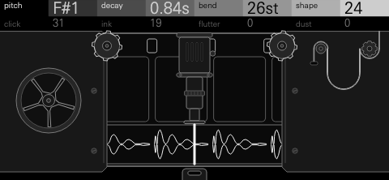
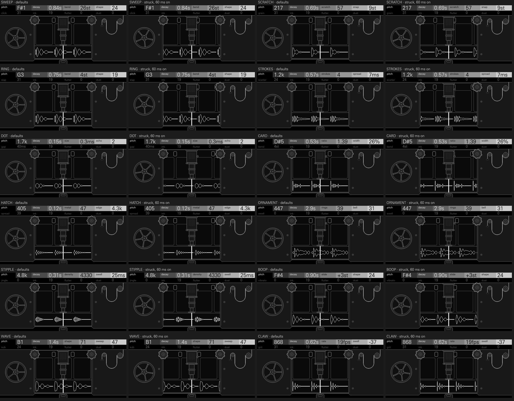

# FLICKER



A drum kit drawn on film. Each of the 24 keys is a shape inked onto the
optical soundtrack of a 16 mm film, the same shape in every frame, and each
hit pulls one more frame of it through a projector's sound head. Round drawn
sines for kicks and toms, inked dots for rims and claves, scratches through
the emulsion for snares, ruled lines for hats, painted rings for rides and
crashes, striped cards for cowbells and beeps, a drawn bass, and the
projector's own claw rattling through its frames. Every sound passes the same
light: the slit's soft top, the valve amplifier's warmth, and, when you ask
for them, the projector's flutter and the dirt on the film.

**Origin:** drawn sound. From the 1930s, animators drew sound straight onto
film. The optical soundtrack is the strip beside the pictures that a
projector's exciter lamp shines through, onto a photocell: whatever is drawn
there is heard. In Leningrad they painted ornaments onto it and played them;
Norman McLaren inked boops, dots and clicks frame by frame and photographed
striped cards for tones; Daphne Oram drew waves on strips of 35 mm film to
play her Oramics machine. A drawing has edges a pen gives it, a slit softens
them, and too much ink spills past the track and is cut off flat: FLICKER
keeps all of that, so the kit sounds drawn.

## Playing it

Load FLICKER on a drum track. The 24 keys start as a kit laid out as stock's
drum kits are: kick, snare, three toms, clap, rim, cowbell, closed and open
hats, ride, crash, then a shaker, a boop, a drawn bass, the claw, and eight
more (a long kick, a tight snare, a pedal hat, a conga, a clave, a beep, a
high boop and a single snap).

- **Eight controls a key.** The four encoders hold the key's first four
  controls; press any encoder to switch them to the second four, and again
  to come back. Both rows are drawn in the header, the one the encoders turn
  bright. The second row ends INK, FLUTTER and DUST on every model.
- **Choose a key's model:** select the key, hold **Shift** and turn
  **encoder 1** (MACHINE). Any key can hold any of the twelve.
- **Its mixer channel, on Shift's first row:** **encoder 2** puts the key in
  choke group 1, 2 or 3, or none (CHOKE: the hats start in group 1);
  **encoder 3** pans it (PAN); **encoder 4** sets its level (LEVEL, 0 dB
  down to -30 dB).
- **Its pad controls and sends, on Shift's second row** (hold Shift and
  press any encoder): **encoder 1** is TUNE, -16 to +15 semitones; **encoder
  2** is SLIT, the projector's sound slit for that key, -8 (narrowed,
  brighter) to +7 (widened, duller), 0 standard; **encoders 3 and 4** (FX I
  and FX II) set the key's own sends: TRK follows the track's send, then 0 to
  100 whatever the track's send is.
- **One voice a key.** A new hit on a key cuts its last one.
- **Saving:** each key's model, controls, choke group, pan, level, TUNE,
  SLIT and sends go in projects and presets.

The OP-XY gives synthesis drum kits no velocity of their own, and applies no
amp envelope (M2) to them: a hit plays to its own end, so its length is
DECAY and the model's own controls.

## The models

The first row starts the same on every model: **PITCH**, the drawing's
spacing (shown as a note on the tuned models, or as the band it rings in),
and **DECAY**, the drawing's taper (shown as the time it takes to fall
40 dB).

| Model | Role | Row 1 | Row 2 |
| --- | --- | --- | --- |
| SWEEP | kick | PITCH DECAY BEND SHAPE | CLICK INK FLUTTER DUST |
| SCRATCH | snare | PITCH DECAY SCRATCH SNAP | GRAIN INK FLUTTER DUST |
| RING | toms, congas | PITCH DECAY BEND SHAPE | SLAP INK FLUTTER DUST |
| STROKES | clap, snap | PITCH DECAY STROKES SPREAD | SCATTER INK FLUTTER DUST |
| DOT | rim, clave, woodblock | PITCH DECAY SIZE ECHO | GAP INK FLUTTER DUST |
| CARD | cowbell, agogo, beeps | PITCH DECAY RATIO WIDTH | BEND INK FLUTTER DUST |
| HATCH | hats | PITCH DECAY METAL EDGE | SPREAD INK FLUTTER DUST |
| ORNAMENT | ride, crash | PITCH DECAY RINGS BELL | SWELL INK FLUTTER DUST |
| STIPPLE | shaker, tambourine | PITCH DECAY DENSITY SWELL | JINGLE INK FLUTTER DUST |
| BOOP | melodic hits, zaps | PITCH DECAY SLIDE SHAPE | VIBRATO INK FLUTTER DUST |
| WAVE | bass | PITCH DECAY SHAPE SWEEP | SUB INK FLUTTER DUST |
| CLAW | rattle, roll, riser | PITCH DECAY RATE SWELL | GRIT INK FLUTTER DUST |

### The controls

Captions are the header's, at 0, 25, 50, 75 and 100 of each control's travel, with the other controls at the model's defaults; the figures are a hit's spectral centroid and the time it takes to fall 40 dB (tools/sweep.py). INK, FLUTTER and DUST are the same on every model.

| Control | Model | 0 / 25 / 50 / 75 / 100 | Measured at 0 / 50 / 100 | What it does |
| --- | --- | --- | --- | --- |
| PITCH | SWEEP | `B0` `E1` `A1` `D2` `G2` | centroid 31, 56, 101 Hz; 40 dB in 0.86, 0.83, 0.84 s | The note the kick falls to. On screen the beads' spacing. |
| DECAY | SWEEP | `0.28s` `0.55s` `1.1s` `2.1s` `4.1s` | centroid 49, 47, 47 Hz; 40 dB in 0.28, 1.06, 4.08 s | How long the drawing tapers. On screen the taper's length, and where its pencil guides meet. |
| BEND | SWEEP | `0st` `12st` `24st` `36st` `48st` | centroid 47, 47, 47 Hz; 40 dB in 0.84, 0.83, 0.83 s | How far above the note it starts, in semitones, falling fast: from a flat sine to a deep drop. On screen the spacing widens along the frame. |
| SHAPE | SWEEP | `0` `25` `50` `75` `100` | centroid 47, 49, 68 Hz; 40 dB in 0.82, 0.83, 0.83 s | Sine, then triangle, then a drawn square with sloped edges: more harmonics a small speaker carries. On screen the beads turn to diamonds and blocks. |
| CLICK | SWEEP | `0` `25` `50` `75` `100` | centroid 47, 47, 47 Hz; 40 dB in 0.83, 0.82, 0.83 s | An inked tick and the scratch of the pen at the start, from none to a hard beater. On screen a tick ahead of the waves. |
| PITCH | SCRATCH | `120` `165` `226` `306` `420` | centroid 1.4k, 1.5k, 1.6k Hz; 40 dB in 0.53, 0.52, 0.53 s | The two drawn tones under the scratches. |
| DECAY | SCRATCH | `0.23s` `0.43s` `0.81s` `1.5s` `2.8s` | centroid 989, 1.5k, 2.2k Hz; 40 dB in 0.20, 0.60, 1.94 s | How long the scratches and tones ring. |
| SCRATCH | SCRATCH | `0` `25` `50` `75` `100` | centroid 347, 1.3k, 3.1k Hz; 40 dB in 0.49, 0.51, 0.58 s | Scratches against tones, from a drawn tom to all wires. |
| SNAP | SCRATCH | `0st` `6st` `12st` `18st` `24st` | centroid 1.4k, 1.5k, 1.5k Hz; 40 dB in 0.53, 0.52, 0.52 s | The tones' bend into their note and a crack on the strike. |
| GRAIN | SCRATCH | `0` `25` `50` `75` `100` | centroid 4.1k, 1.2k, 709 Hz; 40 dB in 0.54, 0.52, 0.52 s | The scratches from fine hiss to a coarse rasp, held longer and lower. |
| PITCH | RING | `A1` `G#2` `G3` `F4` `E5` | centroid 56, 194, 666 Hz; 40 dB in 0.72, 0.75, 0.75 s | The tom's or conga's note. |
| DECAY | RING | `0.23s` `0.49s` `1.0s` `2.2s` `4.6s` | centroid 201, 194, 194 Hz; 40 dB in 0.24, 1.04, 4.57 s | How long it rings. |
| BEND | RING | `0st` `3st` `6st` `9st` `12st` | centroid 194, 195, 196 Hz; 40 dB in 0.75, 0.75, 0.75 s | How far it bends down into its note. |
| SHAPE | RING | `0` `25` `50` `75` `100` | centroid 194, 200, 267 Hz; 40 dB in 0.75, 0.74, 0.76 s | Sine to triangle to drawn square: rounder or more hollow. |
| SLAP | RING | `0` `25` `50` `75` `100` | centroid 194, 194, 194 Hz; 40 dB in 0.75, 0.75, 0.75 s | An inked edge on the attack: a slap's crack and a burst through a band over the note. |
| PITCH | STROKES | `500` `785` `1.2k` `1.9k` `3.0k` | centroid 1.1k, 2.3k, 4.9k Hz; 40 dB in 0.49, 0.49, 0.47 s | The band the strokes ring in. |
| DECAY | STROKES | `0.18s` `0.38s` `0.78s` `1.6s` `3.2s` | centroid 2.1k, 2.2k, 2.2k Hz; 40 dB in 0.15, 0.65, 2.64 s | The smear after the strokes. |
| STROKES | STROKES | `1` `2` `4` `5` `6` | centroid 2.2k, 2.2k, 2.2k Hz; 40 dB in 0.50, 0.49, 0.48 s | How many strokes, one to six. |
| SPREAD | STROKES | `3ms` `5ms` `10ms` `17ms` `30ms` | centroid 2.2k, 2.2k, 2.0k Hz; 40 dB in 0.46, 0.49, 0.49 s | Time between strokes, from one fat clap to a flam. |
| SCATTER | STROKES | `0` `25` `50` `75` `100` | centroid 2.2k, 2.2k, 2.2k Hz; 40 dB in 0.49, 0.49, 0.49 s | From one tight clap to a loose crowd: strokes later and uneven, each in its own tone, the smear many hands. |
| PITCH | DOT | `300` `594` `1.2k` `2.3k` `4.5k` | centroid 301, 998, 2.5k Hz; 40 dB in 0.21, 0.17, 0.16 s | The ring the dot strikes. |
| DECAY | DOT | `46ms` `0.12s` `0.30s` `0.73s` `1.8s` | centroid 1.5k, 881, 977 Hz; 40 dB in 0.12, 0.23, 1.34 s | How long it rings. |
| SIZE | DOT | `0.1ms` `0.2ms` `0.5ms` `1.1ms` `2.5ms` | centroid 1.6k, 1.0k, 657 Hz; 40 dB in 0.16, 0.16, 0.16 s | A small dot rings bright; a large one knocks the wood under it. |
| ECHO | DOT | `0` `2` `3` `4` `6` | centroid 1.6k, 1.4k, 1.3k Hz; 40 dB in 0.15, 0.22, 0.30 s | Dots after the first, each fainter. |
| GAP | DOT | `12ms` `26ms` `55ms` `0.12s` `0.25s` | centroid 1.7k, 1.4k, 1.5k Hz; 40 dB in 0.17, 0.21, 0.61 s | Time between the echoes. |
| PITCH | CARD | `F#3` `E4` `D#5` `D6` `C#7` | centroid 350, 1.2k, 3.8k Hz; 40 dB in 0.48, 0.48, 0.48 s | The lower card's note. |
| DECAY | CARD | `0.14s` `0.33s` `0.77s` `1.8s` `4.1s` | centroid 1.3k, 1.2k, 1.2k Hz; 40 dB in 0.13, 0.69, 3.72 s | How long the cards sound. |
| RATIO | CARD | `1.00` `1.19` `1.42` `1.68` `2.00` | centroid 1.1k, 1.3k, 1.4k Hz; 40 dB in 0.47, 0.48, 0.48 s | The second card's pitch over the first: one tone to two, an octave at the top. |
| WIDTH | CARD | `5%` `16%` `28%` `39%` `50%` | centroid 2.3k, 1.2k, 1.0k Hz; 40 dB in 0.39, 0.48, 0.48 s | The stripes' width: thin and nasal to a square. |
| BEND | CARD | `0st` `6st` `12st` `18st` `24st` | centroid 1.2k, 1.2k, 1.1k Hz; 40 dB in 0.48, 0.48, 0.50 s | A fall into the note, up to two octaves. |
| PITCH | HATCH | `180` `270` `405` `600` `900` | centroid 9.0k, 9.5k, 10.4k Hz; 40 dB in 0.13, 0.13, 0.13 s | The ruled lines' spacing. |
| DECAY | HATCH | `46ms` `0.15s` `0.51s` `1.7s` `5.5s` | centroid 9.5k, 9.7k, 9.6k Hz; 40 dB in 0.05, 0.52, 5.58 s | Closed to open. |
| METAL | HATCH | `0` `25` `50` `75` `100` | centroid 9.7k, 9.5k, 6.0k Hz; 40 dB in 0.13, 0.13, 0.13 s | Scratched noise to ringing ruled lines. |
| EDGE | HATCH | `2.6k` `3.3k` `4.3k` `5.5k` `7.0k` | centroid 9.2k, 9.5k, 10.5k Hz; 40 dB in 0.13, 0.13, 0.13 s | The lines' sharpness: the cut, and its ring. |
| SPREAD | HATCH | `0` `25` `50` `75` `100` | centroid 9.6k, 9.5k, 9.4k Hz; 40 dB in 0.13, 0.13, 0.13 s | How unequally the six hatchings are spaced: closer is more of a chord, wider a cymbal. |
| PITCH | ORNAMENT | `220` `314` `447` `631` `900` | centroid 9.6k, 11.0k, 13.0k Hz; 40 dB in 2.55, 2.66, 2.78 s | The painted rings' size. |
| DECAY | ORNAMENT | `1.2s` `1.7s` `2.6s` `4.0s` `6.0s` | centroid 11.0k, 11.0k, 11.0k Hz; 40 dB in 1.09, 2.49, 5.59 s | How long the wash rings. |
| RINGS | ORNAMENT | `0` `25` `50` `75` `100` | centroid 10.7k, 11.0k, 11.2k Hz; 40 dB in 2.45, 2.72, 2.78 s | How many rings cross, and the scratches between them: a ride to a dense crash. |
| BELL | ORNAMENT | `0` `25` `50` `75` `100` | centroid 11.1k, 10.9k, 10.6k Hz; 40 dB in 2.90, 2.51, 2.19 s | The bell's ping over the wash. |
| SWELL | ORNAMENT | `0` `47ms` `0.11s` `0.26s` `0.60s` | centroid 11.0k, 11.0k, 11.0k Hz; 40 dB in 2.66, 2.86, 2.90 s | The wash blooming in. |
| PITCH | STIPPLE | `2.5k` `3.5k` `4.8k` `6.5k` `9.0k` | centroid 2.5k, 4.6k, 7.2k Hz; 40 dB in 0.32, 0.34, 0.34 s | The band the dots ring in. |
| DECAY | STIPPLE | `0.12s` `0.26s` `0.57s` `1.2s` `2.8s` | centroid 4.8k, 4.7k, 4.7k Hz; 40 dB in 0.14, 0.58, 2.79 s | How long the shake lasts. |
| DENSITY | STIPPLE | `300` `760` `1925` `4738` `9999` | centroid 4.5k, 4.6k, 5.1k Hz; 40 dB in 0.37, 0.33, 0.38 s | Dots a second, from scattered grains to a dense shaker. |
| SWELL | STIPPLE | `0` `16ms` `63ms` `0.14s` `0.25s` | centroid 4.6k, 4.6k, 4.6k Hz; 40 dB in 0.32, 0.37, 0.44 s | The shake easing in. |
| JINGLE | STIPPLE | `0` `25` `50` `75` `100` | centroid 4.6k, 3.8k, 4.1k Hz; 40 dB in 0.34, 0.35, 0.34 s | Dots gathered into clusters that ring small cymbals: a tambourine. |
| PITCH | BOOP | `C2` `D#3` `F#4` `A5` `C7` | centroid 66, 378, 2.1k Hz; 40 dB in 0.91, 0.91, 0.91 s | The note. |
| DECAY | BOOP | `0.23s` `0.55s` `1.3s` `3.1s` `7.4s` | centroid 388, 378, 378 Hz; 40 dB in 0.24, 1.34, 7.42 s | How long it sounds. |
| SLIDE | BOOP | `-24st` `-12st` `0st` `+12st` `+24st` | centroid 375, 378, 381 Hz; 40 dB in 0.91, 0.91, 0.92 s | Slides in from below (down to -24 semitones) or above (+24). |
| SHAPE | BOOP | `0` `25` `50` `75` `100` | centroid 376, 387, 513 Hz; 40 dB in 0.91, 0.91, 0.92 s | Sine to triangle to drawn square. |
| VIBRATO | BOOP | `0` `25` `50` `75` `100` | centroid 378, 378, 379 Hz; 40 dB in 0.91, 0.92, 0.92 s | The drawing's waver, up to two semitones. |
| PITCH | WAVE | `A0` `F#1` `D#2` `C3` `A3` | centroid 38, 87, 221 Hz; 40 dB in 1.46, 1.44, 1.46 s | The bass note. |
| DECAY | WAVE | `0.37s` `0.78s` `1.7s` `3.5s` `7.4s` | centroid 73, 70, 67 Hz; 40 dB in 0.39, 1.71, 7.54 s | How long it sounds. |
| SHAPE | WAVE | `0` `25` `50` `75` `100` | centroid 58, 59, 78 Hz; 40 dB in 1.45, 1.45, 1.42 s | Sine to triangle to drawn square. |
| SWEEP | WAVE | `0` `25` `50` `75` `100` | centroid 70, 69, 62 Hz; 40 dB in 1.42, 1.42, 1.52 s | A low-pass that closes from open over the note: a pluck. |
| SUB | WAVE | `0` `25` `50` `75` `100` | centroid 76, 60, 40 Hz; 40 dB in 1.43, 1.45, 1.51 s | A drawn octave under it, taking the wave's place. |
| PITCH | CLAW | `250` `486` `945` `1.8k` `3.5k` | centroid 265, 956, 3.5k Hz; 40 dB in 0.68, 0.69, 0.66 s | The ring each pull strikes. |
| DECAY | CLAW | `0.15s` `0.32s` `0.68s` `1.4s` `3.0s` | centroid 882, 881, 884 Hz; 40 dB in 0.22, 0.74, 3.08 s | How long the claw runs. |
| RATE | CLAW | `6fps` `11fps` `19fps` `34fps` `60fps` | centroid 881, 882, 882 Hz; 40 dB in 0.64, 0.68, 0.72 s | Pulls a second. |
| SWELL | CLAW | `-100` `-50` `+1` `+50` `+100` | centroid 881, 883, 886 Hz; 40 dB in 0.69, 0.69, 0.73 s | A roll that dies away (-100), an even one (0), or a riser that quickens and swells (+100). |
| GRIT | CLAW | `0` `25` `50` `75` `100` | centroid 869, 933, 1.1k Hz; 40 dB in 0.68, 0.68, 0.69 s | Each tick from clean to gritty. |
| INK | all | `0` `25` `50` `75` `100` | kick centroid 47, 47, 48 Hz; hat 5.3k, 9.5k, 9.6k Hz | The ink's weight: thin ink bleeds soft (to 21), full ink is crisp, heavy ink spills past the track's edges and is cut flat, harder as it grows. On screen the weight of the ink and of the pencil guides, then a drawing that grows and flattens at the edges. |
| FLUTTER | all | `0` `25` `50` `75` `100` | kick centroid 47, 49, 49 Hz; hat 9.5k, 9.6k, 9.5k Hz | The projector's claw at 24 Hz in the film's speed and light, and the loop's wow: every pitch wavers, the light flickers. On screen the gate's bar rises up its posts and chatters as the film is pulled. |
| DUST | all | `0` `25` `50` `75` `100` | kick centroid 47, 98, 81 Hz; hat 9.5k, 1.0k, 1.1k Hz | Specks that pop, grain that crackles, a hair across the track, the same each time the key plays. On screen specks settle on every frame and bite the drawing. |

## Presets

The init preset is the default kit. Eight kit presets lay out the 24 keys
for a style, each key with its own pan, level, TUNE, SLIT and sends where the
style wants them.

| Preset | For | What it does |
| --- | --- | --- |
| **talkie** | lo-fi house, chillhop | Clean, round and soft: a sine kick with a small tick, a soft snare, gentle hats, a shaker that swells, the ride's bell, boops on A and E, a round drawn bass. |
| **newsreel** | boom bap | 1940s film: every key inked heavier and played through a worn projector (dust, flutter, a wider slit): a thick kick, a raspy snare, the claw's rattle. |
| **synchromy** | melodic percussion | Striped cards and boops tuned to a pentatonic scale by TUNE, rings tuned as toms, a drawn bass on C, a narrowed slit. |
| **ornament** | electro, IDM | Metallic and dense: drawn-square kicks with a hard tick, ringing ruled hats, the densest ornaments, echoing dots, odd cards, the slit narrowed right down. |
| **cartoon** | cartoon, game | Boops that slide up and down, dots that bounce, a claw that winds up, cards that drop, toms that zip. |
| **nitrate** | lo-fi hip hop | Inked hot, dusty and crunchy, through a wide slit, the film fluttering a little. |
| **oramics** | 808 style | Long drawn sweeps for kicks, a drawn bass on four notes of a line, tight hats, a clap with a long smear. |
| **projector** | techno | Inked kicks with a hard tick, the claw rattling in sixteenths, tight hats, a dry clap, the projector's flutter just showing. |

Demos: [docs/demo-hits.mp3](docs/demo-hits.mp3) (the default kit, key by
key), [docs/demo-talkie.mp3](docs/demo-talkie.mp3),
[docs/demo-newsreel.mp3](docs/demo-newsreel.mp3) and
[docs/demo-projector.mp3](docs/demo-projector.mp3). Rendered from the engine
on a computer, stereo 44.1 kHz, each key at its own pan and level, the
grooves' softer hits set by a held step's LEVEL lock as a player would on the
OP-XY, with no other processing; each file normalised to -16 LUFS integrated
(BS.1770) or to a -1 dBFS peak where that is lower.

## How it works

Every model draws its own shape (models.h); every drawing then passes the
same projector (engine.cpp):

**the drawing** → **the ink** → **the dirt on the film** → **the slit** →
**the photocell** → **the valve** → **the coupling capacitor**

- **The drawings.** Waves whose spacing widens (a falling pitch) and whose
  height tapers; drawn squares with sloped edges, as a pen draws them (a
  sine bent to a triangle, then drawn taller than the track and cut flat);
  stripes for pulse tones; inked dots ringing the light; scratches through
  the emulsion, fine or coarse; ruled lines, six hatchings at their own
  spacings; painted rings crossing each other; stippled dots at random.
- **The ink.** INK is the ink's weight. A thin, watery ink bleeds into the
  film and its edges go soft; a full ink sits crisp; laid on heavily, the
  drawing reaches past the track's edges and is cut off there, the cut
  harder the heavier the ink.
- **The projector.** The slit averages the track over its width, a gentle
  top that SLIT moves; the valve amplifier adds a warm, even bend to what is
  low and round; the coupling capacitor takes out what is under 25 Hz.
  FLUTTER is the claw pulling each frame down: 24 times a second the film's
  speed and its light flicker, and the loop above the gate breathes in a
  slow wow, which every pitch on the film follows. DUST is dirt on the film:
  specks that pop, grain that crackles and a hair across the track, the
  same each time a key plays.

**Level.** Every model is set by loudness, not by its peak
(tools/calibrate.py writes levels.h). Measured as a hit's loudest 400 ms,
K-weighted (BS.1770), against the SDK's half-scale ceiling, every model's
default hit sits at its role's loudness: SWEEP and RING at -16.5 LUFS, the
other ten at -19, each within 1 LU, its true peak (4x oversampled) at least
1 dB under the ceiling. Each control carries two trims, at nine points of
its travel: one holds the hit's loudness as the control turns, the other
tracks how far that lifts its peak, and the engine takes a hit down only by
what all eight together lift its peak past the room its default leaves. A
click, a snap and a slap are held by a transient limiter instead, so they
change the attack and the body keeps its level; the clap, the dots, the
claw, the hats and the shaker run it too. A soft knee over the last quarter
under the ceiling catches what is left. Every key of the default kit plays
at 0 dB:

| Key | Model | LUFS-M (re the ceiling) | True peak (dB re the ceiling) |
| --- | --- | ---: | ---: |
| 53 | SWEEP | -16.4 | -1.7 |
| 54 | SCRATCH | -19.0 | -4.0 |
| 55 | RING | -16.5 | -3.1 |
| 56 | RING | -16.5 | -3.6 |
| 57 | RING | -16.6 | -4.1 |
| 58 | STROKES | -18.9 | -1.8 |
| 59 | DOT | -19.5 | -2.6 |
| 60 | CARD | -19.1 | -2.7 |
| 61 | HATCH | -19.4 | -1.4 |
| 62 | HATCH | -19.5 | -9.5 |
| 63 | ORNAMENT | -19.2 | -8.2 |
| 64 | ORNAMENT | -18.9 | -8.8 |
| 65 | STIPPLE | -19.1 | -1.8 |
| 66 | BOOP | -19.0 | -8.3 |
| 67 | WAVE | -18.8 | -6.5 |
| 68 | CLAW | -19.5 | -7.3 |
| 69 | SWEEP | -16.3 | -3.8 |
| 70 | SCRATCH | -19.0 | -2.2 |
| 71 | HATCH | -19.8 | -1.1 |
| 72 | RING | -16.5 | -1.9 |
| 73 | DOT | -18.4 | -1.9 |
| 74 | CARD | -19.3 | -2.6 |
| 75 | BOOP | -19.1 | -7.9 |
| 76 | STROKES | -19.8 | -1.9 |

A preset key whose settings still sound over its role's loudness is cut to
it by its LEVEL (tools/presets.py LEVELS).

**Ending.** A voice stops once its output has stayed under -96 dB for 90 ms
with nothing still to come (a stroke, an echo, a claw's tick), and tells the
SDK it has finished, so it frees up.

No code, table or constant here comes from any drum machine or recording:
every sound is drawn from its shapes and the projector's physics.

## Screen



Four frames of 16 mm sound film lie on a near-black slat, drawn isometric,
with a small gate bridging the film at its middle. Along the film's back edge
run its perforations and empty picture frames, dim; along its front edge, the
soundtrack, where the selected key's sound is drawn in fine white line, the
same drawing in every frame, as a variable-area track looks: beads and
diamonds for waves, blocks for drawn squares, combs for ruled lines, dots for
dots. Under the clear film the slat carries an animator's pencil guides for
each frame and a scale along its front edge, and under the gate the slit's
light crosses the track.

A hit pulls the film one frame along, easing in and settling over the hit's
own length: the drawing passes under the slit as it plays, and the next
frame's identical drawing takes its place. The frame at the near end slips
over the slat's edge into the dark as a new one comes up over the far end.
Only the selected key's notes pull it, a still screen changes nothing, and
reduced motion keeps it still.

Each part takes the grey of the encoder that moves it, on both pages:

- **The drawing** (encoder 1, its outline): PITCH spaces its waves, and on the
  second page the model's own control (CLICK, GRAIN, SLAP and the rest) is a
  feature of the drawing.
- **The pencil guides** (encoder 2, dark grey): DECAY sets where the guides of
  the taper meet. INK sets the weight of the guides and of the ink; heavy ink
  also draws taller, until it spills past the track's edges and is cut flat.
- **The gate** (encoder 3, mid grey): FLUTTER lifts its bar up its posts,
  away from the film, and a lifted bar chatters as the film is pulled. On the
  first page the model's third control shows in the drawing: BEND as the
  crowding of its first waves against the scale.
- **The dust** (encoder 4, light grey): DUST settles specks on the film, the
  same on every frame, more and larger as it rises, and bites them out of the
  drawing. On the first page the model's fourth control shows in the
  drawing's form: SHAPE takes it from round beads to blocks.

SLIT widens the slit's line; TUNE moves PITCH's spacing and its caption.

Contact sheets of each model's controls at 0, 50 and 100, its hits and both
Shift rows, at 1:1: [docs/sheets/](docs/sheets/).

## CPU

An estimate, counted in the compiled Blackfin code rather than measured on
an OP-XY. tools/static_cpu.py builds the module with the SDK's pinned
compiler, disassembles a voice and counts, for each model, the instructions
of its worst block: every per-sample loop 64 times, every other instruction
once (every branch taken, every path run), with the projector around the
drawing (ink, dust, slit, valve, capacitor, the limiter where the model runs
it, the knee), the SDK's own work for the voice (its pan, level and sends)
and the note's start (its setup) all in the same block. Instructions per
64-sample block, an upper bound, and beside it the same block's per-sample
loops (the drawing's and the projector's), the note's start and its setup
alone, a closer estimate:

| Model | Worst block, bound | Share | Per-sample loops and the note's start | Share |
| --- | ---: | ---: | ---: | ---: |
| SWEEP | 24,120 | 4.16% | 15,140 | 2.61% |
| SCRATCH | 26,443 | 4.56% | 16,334 | 2.81% |
| RING | 29,664 | 5.11% | 19,594 | 3.38% |
| STROKES | 24,906 | 4.29% | 15,951 | 2.75% |
| DOT | 26,495 | 4.57% | 17,611 | 3.03% |
| CARD | 20,030 | 3.45% | 15,430 | 2.66% |
| HATCH | 27,987 | 4.82% | 19,077 | 3.29% |
| ORNAMENT | 22,609 | 3.90% | 17,941 | 3.09% |
| STIPPLE | 26,609 | 4.58% | 17,707 | 3.05% |
| BOOP | 18,320 | 3.16% | 13,856 | 2.39% |
| WAVE | 20,888 | 3.60% | 16,403 | 2.83% |
| CLAW | 25,564 | 4.40% | 16,541 | 2.85% |

A block in which a voice only plays on, with DUST at 0 and nothing near the
ceiling, runs well under these: the note's start, the dust, the knee and the
limiter are each only in some blocks. Up to 16 voices; a silent voice frees
itself. No divides run per sample, and nothing is floating point.

## Memory

105.1 KiB of the 2032 KiB module region (`sdk.py test --firmware`): the
code, the tables, the screen's artwork (24 KB) and its state, and 16 voices
and a spare at 520 bytes each.

## Building

FLICKER needs SDK 1.10 (synthesis drum kits with a mixer channel a key).
tools/presets.py writes the kit presets into a build.

```sh
python ../open-xy/sdk.py test --machine flicker
python ../open-xy/sdk.py test --machine flicker --firmware
python ../open-xy/sdk.py build --machine flicker ... --out <build>
python3 flicker/tools/presets.py --out <build>/candidate
```

## Files

- `engine.cpp`, `core.h`: the kit's callbacks, the projector, and a note from
  start to silence.
- `models.h`: the twelve drawings; `voice.h`: a voice and the ink's cut;
  `dsp.h`, `units.h`: fixed-point helpers; `ranges.h`: the controls' ends,
  shared with the screen; `kit.h`: the models and the default kit;
  `tables.h`, `levels.h`: generated.
- `display.cpp`, `display.h`, `art.h`, `panel.svg.fragment`: the screen.
- `tests/`: sound, pad controls and screen checks, run by `sdk.py test`.
- `tools/`: `make_tables.py`, `make_panel.py`, `calibrate.py` (the generated
  files); `presets.py`; `render.cpp`, `sweep.py`, `demo.py`, `frames.cpp`,
  `make_sheet.py`, `static_cpu.py` (measuring and rendering); `ub.sh`,
  `ub_audio.cpp`, `ub_display.cpp`, `ub_scenarios.py` (the checks against
  undefined behaviour and compiler differences).

## Licence

MIT ([LICENSE](../LICENSE)).
